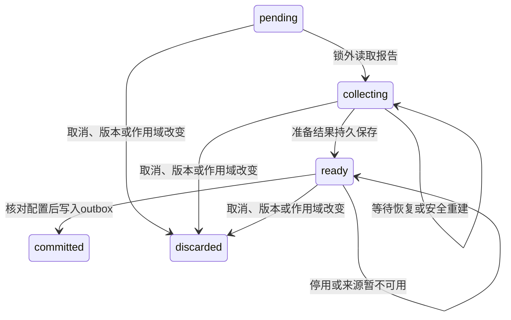

# 信息事件持久队列与恢复

第191批将 `source.poll_events` 和事件报告读取移出配置锁及 SQLite 写事务。轮询或投影尚未返回时，状态查询、取消、更新和全局停用可以处理；结果提交前仍检查订阅和报告版本、绑定与当前作用域。

## 先保存事件，再读取报告

来源返回一批事件后，服务用短事务一起保存游标、原始事件、指纹和当时匹配的订阅／报告版本。此后才在锁外读取各份报告。`info_events` 保存事件身份，新增 `info_event_targets` 记录每个目标的处理状态；事件结果和目标的 committed 状态在同一事务提交。

`committed` 只说明结果已写入服务 outbox，不证明外部发送成功或 LLM 已读。已经提交的目标不会再次读取或创建第二份结果。待处理事件只有在其目标全部提交或因控制操作失效后，才从 pending 队列移除。

接收目标在批次进入队列时冻结。读取中取消或更新的旧目标不再发布；后来创建的订阅不接收这批旧事件。首次升级前已存在的旧 pending 数据没有目标快照，会按旧行为在第一次处理时使用当前订阅集合；一旦建立台账，目标集合便不再扩张。

预算不足时保留完整待处理载荷，下次处理它们不重新调用来源轮询。为避免一组事件的多个订阅永久饥饿，保留原先首组可超出单次结果预算的行为。同事件 ID 对应不同载荷时记录 `event_identity_conflict`，不创建第二份通知。

## 停用、暂时故障与作用域变化

读取期间全局停用时，已经完成的投影保存为 ready，暂不发布。恢复启用后直接使用该准备结果，不重复轮询或读取；结果仍保留原采集时间和上下文，不能当成恢复时重新采样的当前值。

来源暂时 unready 与明确的 session/world/观察国变化分别处理。健康状态暂不明确时保留原始 pending 及 ready 结果；尚未得到可用投影的目标等待恢复。确认作用域或订阅／报告版本改变时，旧目标被撤回，不能改投到新配置。

## 中断恢复不会自动重查当前状态

恢复中断投影只调用来源明确提供的 `replay_event(query, context, event)`。默认没有这个接口，不会退回普通 `read` 或 `read_event`；服务仍创建带原事件的未知结果，字段原因是 `EVENT_PROJECTION_INTERRUPTED_NOT_REPLAYED`，避免静默漏掉通知或重做当前状态查询。

- RecordedSource 从固定 archive 重建。
- BattleInformationSource 从持久战报及历史页重建，保留原身份、选择器、日期和载荷校验，绕过 `_refresh` 与 ingestor。
- CompositeSource 为各字段所有者建立短命安全视图；没有明确重建接口的部分返回未知，不临时替换运行中来源。

普通 `poll_events` 不能一概视为无副作用。某些来源会推进本地 tail／ingest 管线；本批保证已入队批次不重新轮询，不能用服务事务回滚来源自身的效果。批次尚未持久保存前的进程中断，还依赖来源的持久性和游标契约。本次没有调用生产者启停或引入新的游戏业务入口。

## 验证范围

143个相关用例有通过记录，覆盖原服务／MCP与战报回归、轮询和投影的真实 Event 阻塞、取消／更新、预算、指纹冲突、中断恢复、未知回退及暂时 unready。完整测试集未在本批重验，`whole_suite_passed=false` 保持。

三组真实 stdio MCP 进程使用明确的生成记录来源和可控 gate：

- 在 poll 和投影阻塞时仍能查询或控制；轮询中取消的目标没有结果，停用期间结果保留，恢复后只发布一次，晚建订阅没有收到旧批次。
- 来源暂时 unready 后目标没有被误丢弃，恢复时只做一次安全重建；前两组的普通投影均只执行一次，来源初始游标也只轮询一次。

第三组在 poll 返回后健康状态暂不明确时，仍保存原始批次和游标；恢复后只执行一次普通投影，不重新轮询。

这些是协议与调度验证，不是新的实机战报采集。未访问游戏、未读取真实 `.eu4`、未执行外交动作、推进、保存重启、注入、采集窗口或 computer use。最近实机状态沿用第190批记录，本批不作新的暂停或战报状态声明。

同库采集锁和 tick 非重入保护继续保留。普通 MCP RPC 同一输入流仍串行，生产者 `sync_subscriptions` 的原锁边界也未改变。覆盖仍为61 available、256 partial、80 planned；完整74主题397字段与原阶段范围继续开发。

证据：`work/runtime/information-event-scheduler-20261105-191-001/summary.json`。
